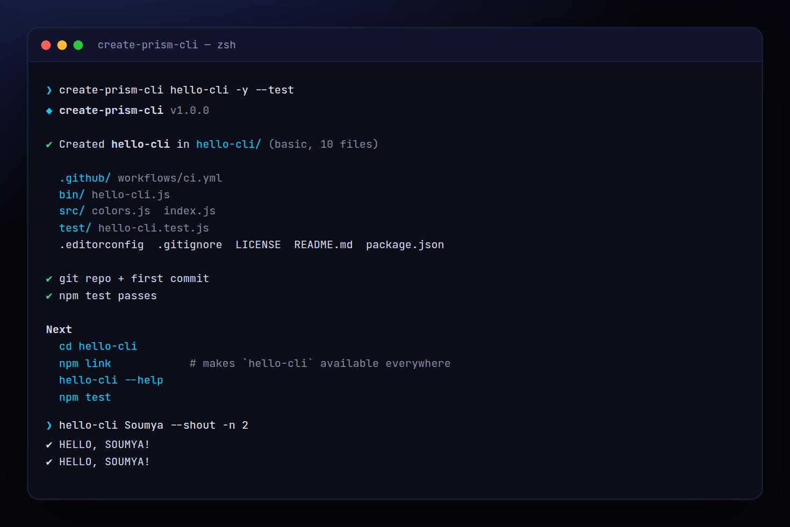

<!-- ═════════════ HEADER ═════════════ -->
<p align="center">
  
</p>

<p align="center">
  
</p>

<p align="center">
  <a href="https://github.com/krishyaa06/prism-create-cli/actions/workflows/ci.yml"></a>
  
  
  <a href="LICENSE"></a>
</p>

<p align="center">
  
</p>


## ⚡ Overview

**Prism Create CLI** (`create-prism-cli`) is the starter behind the Prism CLIs. Answer four questions (or pass flags) and you get a working, tested, zero-dependency Node.js command-line tool: argument parsing with `node:util` `parseArgs`, colours that respect `NO_COLOR`, proper exit codes, `node:test` tests that already pass, a README, an MIT license and a GitHub Actions matrix. Pick `basic` for a single command with flags or `commands` for git-style subcommands.

## ✨ Features

- **Two templates**: `basic` (flags, positional args, JSON output) and `commands` (add / list subcommands with per-command help)
- **Zero dependencies** in the generated project — only Node built-ins
- **Tests included** with `node:test`, passing out of the box (`--test` verifies)
- **CI matrix**: Ubuntu, Windows, macOS × Node 18 / 20 / 22
- README, MIT LICENSE (author from git), `.editorconfig`, `.gitignore`, git init + first commit
- Interactive prompts, or fully scripted with `-y` and flags

## 🚀 Quick Start

```bash
# run without installing
npx github:krishyaa06/prism-create-cli my-cli

# or install globally
npm install -g github:krishyaa06/prism-create-cli
create-prism-cli my-cli -t commands
```

Requires Node.js 18.17+. No dependencies.

## 🛠️ Usage

```text
create-prism-cli [dir] [options]      asks for anything missing (unless -y)

  -n, --name <pkg>        package name (default: folder name)
  -b, --bin <cmd>         command name
  -d, --desc <text>       one-line description
  -t, --template <t>      basic | commands
  -a, --author <name>     author (default: git user.name)
  -r, --repo <owner/repo> GitHub repo for package.json + README
      --no-git            skip git init + first commit
      --test              run the generated tests
  -y, --yes               accept defaults, no prompts
  -f, --force             write into a non-empty folder
```

### What you get (`basic`)

```text
my-cli/
├── .github/workflows/ci.yml
├── bin/my-cli.js        parseArgs, help, exit codes
├── src/index.js         your logic (pure, testable)
├── src/colors.js        NO_COLOR-aware colours
├── test/my-cli.test.js  node:test
├── README.md  LICENSE  package.json  .editorconfig  .gitignore
```

## 📁 Project Structure

```text
prism-create-cli/
├── assets/
│   ├── logo.png
│   └── logo.svg
├── bin/
│   └── create-prism-cli.js   # CLI entry
├── src/
│   ├── index.js   # scaffold + git init
│   ├── templates.js   # generated files (basic / commands)
│   └── ui.js   # colours, tables
├── test/
│   └── create.test.js
├── .gitignore
├── LICENSE
└── package.json
```

## 🧪 Tests

```bash
npm test
```

Tests use the built-in `node:test` runner, so there is nothing to install. CI runs them on Node 20 and 22.

## 🤝 Contributing

1. Fork the repo and create a branch: `git checkout -b feature/my-idea`
2. Make your change and add a test in `test/`
3. Run `npm test` and open a Pull Request

## 🔷 Part of Prism Protocol

Prism Create CLI is one of the open-source tools built by [Prism Protocol](https://dc.gg/prismprotocol), a tech community where young builders learn, ship and compete together.

## 👤 Author

<table>
  <tr>
    <td align="center">
      <a href="https://github.com/krishyaa06"><br><b>Soumya Bhandare</b></a><br>
      <sub>Founder @ Prism Protocol</sub>
    </td>
    <td>
      <a href="https://dc.gg/prismprotocol"></a><br>
      <a href="https://instagram.com/prism_protocol_"></a><br>
      <a href="https://x.com/krishyaa06"></a>
    </td>
  </tr>
</table>

## 📄 License

Released under the [MIT License](LICENSE).

<p align="center">
  <b>If you like this project, consider giving it a ⭐</b><br>
  <sub>"Build. Create. Compete." · Made with ⚡ by Prism Protocol</sub>
</p>


